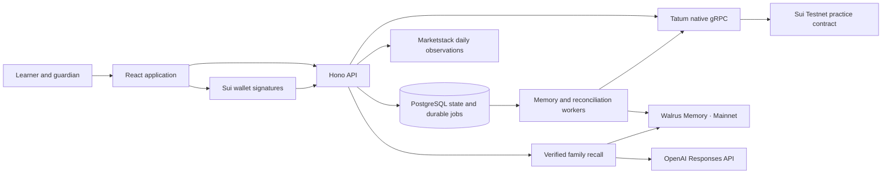

<p align="center">
  
</p>

<h1 align="center">Trove</h1>

<p align="center"><strong>Grow your own way.</strong></p>

<p align="center">
  A family investing simulator that remembers how you learn.<br />
  Explore real markets, practise inside guardian-set limits, and turn each decision into understanding.
</p>

<p align="center">
  <a href="#getting-started">Getting started</a> ·
  <a href="#how-trove-works">How it works</a> ·
  <a href="#architecture">Architecture</a> ·
  <a href="docs/VERCEL-DEPLOY.md">Deployment</a> ·
  <a href="#license">License</a>
</p>

<p align="center">
  
  
  
  
  
</p>
<p align="center">
  
  
  
  
  
</p>

---

## Contents

- [Overview](#overview)
- [How Trove works](#how-trove-works)
- [Architecture](#architecture)
- [Technology stack](#technology-stack)
- [Getting started](#getting-started)
- [Configuration](#configuration)
- [Market data and accounting](#market-data-and-accounting)
- [Sui practice accounts](#sui-practice-accounts)
- [Memory and learning](#memory-and-learning)
- [API reference](#api-reference)
- [Development and validation](#development-and-validation)
- [Deployment](#deployment)
- [Repository structure](#repository-structure)
- [Documentation](#documentation)
- [Data handling](#data-handling)
- [Contributing](#contributing)
- [License](#license)
- [Third-party notices](#third-party-notices)

## Overview

Trove gives learners a $1,000 simulated portfolio, real daily market observations, and space to explain their choices. A guardian sets the boundaries. The learner explores companies, practises buying and selling, revisits decisions, and works through short investing exercises.

The learning guide carries context across sessions through Walrus Memory. It connects new questions to the learner's earlier reasons, reflections, corrections, and concept checks, with references to the saved evidence.

| Capability         | What it does                                                                                              |
| ------------------ | --------------------------------------------------------------------------------------------------------- |
| Portfolio          | Tracks cash, positions, cost basis, returns, and dated portfolio values.                                  |
| Explore            | Searches twelve companies and broad-market funds, with official brand assets and interactive charts.      |
| Practice orders    | Reviews a dated quote before executing an integer-based simulated buy or sale.                            |
| Guardian controls  | Sets per-trade and daily limits, pauses activity, and approves an exact one-time exception.               |
| Decision journal   | Keeps original reasons alongside reflections, corrections, corporate actions, and transaction receipts.   |
| Replay             | Compares allocations using the same starting capital and adjusted market observations.                    |
| Learning           | Adapts foundation and transfer exercises across eight investing concepts.                                 |
| Remembered guide   | Uses confirmed, active Walrus memories to explain ideas in the learner's own context.                     |
| Corporate actions  | Applies forward and reverse splits, dividend credits, and share-precision cash remainders automatically.  |
| Wallet enforcement | Uses separate guardian and learner signatures, sponsored Sui Testnet execution, and Tatum reconciliation. |

## How Trove works

1. **Create a family.** The guardian creates an account and generates a single-use learner invitation.
2. **Join separately.** The learner accepts the invitation with their own credentials.
3. **Set boundaries.** The guardian chooses trade limits and a daily allowance.
4. **Make a choice.** The learner explores an instrument, enters an amount and a reason, then reviews the quote.
5. **Ask at the boundary.** An above-limit choice goes to the guardian for approval of that exact order.
6. **Learn from it.** The learner reviews the decision, compares alternatives, records a reflection, and completes a concept check.
7. **Carry understanding forward.** With remembering enabled, the guide retrieves confirmed learning records in later sessions.

Account settings connect each role to a separate Sui wallet. Starting Sui practice archives the earlier portfolio and opens a contract-backed simulated account. The guardian signs controls; the learner signs orders; the server sponsors Testnet gas.

## Architecture



The server owns authentication, quote construction, provider credentials, consent checks, durable jobs, and receipt validation. Shared TypeScript modules implement deterministic accounting and learning rules. The Move contract enforces wallet authority and signed financial transitions.

The hosted application serves its compiled frontend and API from one Vercel project. PostgreSQL stores family state, immutable market snapshots, transaction intents, portfolio observations, memory jobs, and model-usage reservations. Local development also supports SQLite.

| Layer            | Responsibility                                                                                                 |
| ---------------- | -------------------------------------------------------------------------------------------------------------- |
| Browser          | Navigation, charts, order review, learning interactions, wallet connection and signing.                        |
| API              | Family isolation, validated inputs, permissions, quote preparation, and integration orchestration.             |
| Accounting       | Fixed-point arithmetic, cost basis, corporate actions, portfolio valuation, and replay.                        |
| Sui contract     | Guardian policy, learner execution, approvals, attested prices, sequence checks, and adjustment deduplication. |
| Workers          | Memory publication, confirmation polling, same-transaction recovery, and corporate-action settlement.          |
| Learning service | Scoped recall, correction resolution, citation validation, caching, and usage control.                         |

## Technology stack

| Area                | Technology                                                                       |
| ------------------- | -------------------------------------------------------------------------------- |
| Application         | TypeScript 6, React 19, React Router 7, Vite 8                                   |
| Styling             | Tailwind CSS 4, custom CSS, SVG and Canvas, IBM Plex Mono                        |
| Charts              | TradingView Lightweight Charts 5                                                 |
| Backend             | Node.js 24, Hono, Zod                                                            |
| Persistence         | PostgreSQL on Neon, transaction-scoped connections, SQLite for local development |
| Blockchain          | Sui Move, Mysten Sui SDK, Wallet Standard                                        |
| Chain transport     | Tatum native TLS gRPC, protobuf-ts, grpc-js                                      |
| Memory              | Walrus Memory SDK and managed Mainnet relayer                                    |
| AI                  | OpenAI Responses API with structured output                                      |
| Market observations | Marketstack daily closes and corporate-action fields                             |
| Validation          | Node test runner, Move tests, Playwright, TypeScript, Oxlint                     |
| Delivery            | Vercel Node functions and CDN, Neon PostgreSQL                                   |

## Getting started

### Requirements

- A patched **Node.js 24** release with npm.
- Git.
- Chromium for browser tests.
- The pinned **Sui testnet-v1.82.2** CLI for contract development.

### Install and run

```sh
git clone https://github.com/ELLA0VICTOR/trove.git
cd trove
npm ci
npm run dev
```

Open **http://127.0.0.1:5173**. Vite runs on port 5173 and proxies API requests to the Node server on port 3001. On Windows, use `npm.cmd` if PowerShell execution policy blocks `npm.ps1`.

Visitors can browse market prices and complete investing lessons. Family sign-in opens the portfolio, practice investing, saved decisions, and parent controls. Ask Trove requires a signed-in learner; parent-enabled remembering connects the guide to saved learning. Each family shares a learner portfolio starting with $1,000 in practice cash and real daily closing prices from a fresh Marketstack snapshot. Parents can add simulated funds while preserving learning history, holdings, and spending controls. Investment returns exclude supplied capital. Earlier example portfolios are archived before switching price basis. Offline development uses authored market history.

### Connect services

Copy `.env.example` to `.env.local`, then fill in the provider values using the [account setup guide](docs/ACCOUNT-SETUP.md).

```sh
npm run setup:check
npm run sui:setup
npm run dev
```

`setup:check` validates configuration without printing secret values. `sui:setup` prepares local Testnet signers and reports the sponsor's funding status.

## Configuration

All provider credentials belong on the server. Local development loads `.env.local`; production reads the host's environment.

| Variable                  | Purpose                                                                                |
| ------------------------- | -------------------------------------------------------------------------------------- |
| `TATUM_API_KEY`           | Tatum Sui Testnet reads, execution, and reconciliation.                                |
| `DATABASE_URL`            | Neon pooled PostgreSQL URI for hosted storage.                                         |
| `MARKETSTACK_API_KEY`     | Shared market-history imports.                                                         |
| `MEMWAL_ACCOUNT_ID`       | Walrus Memory account identifier.                                                      |
| `MEMWAL_PRIVATE_KEY`      | Memory delegate signing key.                                                           |
| `MEMWAL_SERVER_URL`       | Relayer URL; defaults to `https://relayer.memory.walrus.xyz`.                          |
| `OPENAI_API_KEY`          | Learning-guide generation.                                                             |
| `COACH_MODEL`             | Configured model; default `gpt-6-luna`.                                                |
| `COACH_BUDGET_USD`        | Persistent estimated usage allowance; local default `1.00`.                            |
| `SUI_PACKAGE_ID`          | Current callable package; defaults to the checked-in deployment manifest.              |
| `SUI_ORIGINAL_PACKAGE_ID` | Original account type identity; resolved from the manifest for the bundled deployment. |
| `SUI_TESTNET_SPONSOR_KEY` | Testnet transaction sponsor.                                                           |
| `SUI_QUOTE_ATTESTOR_KEY`  | Ed25519 signer for price and corporate-action attestations.                            |
| `TROVE_DATA_DIR`          | Local SQLite directory when DATABASE_URL is absent; defaults to `.trove`.              |
| `PUBLIC_ORIGIN`           | Trusted public origin; Vercel deployment URLs are detected automatically.              |
| `PORT`                    | HTTP port; defaults to `3001`.                                                         |
| `TROVE_LIVE_SERVICES`     | Set to `0` for deterministic offline development.                                      |

The local setup helper stores generated Testnet keys in ignored `.trove/sui-testnet-keys.json`. Hosted services use environment variables. The bundled manifest resolves the current package and original type identity automatically.

## Market data and accounting

Trove imports validated USD observations into immutable, hashed snapshots. Every order binds its portfolio, dataset, symbol, price, policy revision, sequence, and expiration. Market charts and replay use provider-adjusted closes; practice fills use the displayed raw closing price.

Money uses **six decimal places** and share quantities use **eight decimal places**. Ledger calculations use integer arithmetic in TypeScript and Move. Sales release cost basis proportionally; residual cash remains explicit.

### Splits and dividends

A snapshot transition processes corporate events in date order, with splits before dividends on the same instrument and day.

- Forward and reverse splits update the share quantity and preserve the remaining position's cost basis.
- Fractions below share precision settle as simulated cash at the event's post-split closing price, with the corresponding cost basis released.
- Dividends credit held shares at the provider's per-share distribution rate. Trove books these simulated credits when it adopts the snapshot containing the provider's event date.
- Each event has a stable identity and posts once per portfolio. Archived snapshots retain events after they leave the current import window.
- Contract-backed portfolios apply the same entries through signed Move calls and advance their price snapshot after receipt and account-state validation.

Corporate entries retain before/after quantities, cash credits, cost releases, snapshot references, and confirmation digests. Recorded portfolio observations preserve the value seen before later share adjustments.

The importer shares one cache across families and reserves its refresh interval before network requests. Its four-day cadence bounds twelve symbols to roughly 96 symbol-requests per 31 days. Orders require a snapshot within the configured five-day freshness window.

## Sui practice accounts

The [public deployment manifest](contracts/practice/deployment.testnet.json) records the package, original type identity, upgrade receipt, bytecode hash, and compiler release.

Each account fixes a guardian, learner, and price-attestor public key. Signed quotes bind the account, amounts, integer units, market date, dataset hash, expiry, revision, sequence, nonce, and a salted reasoning commitment.

The contract enforces available cash and shares, allowed symbols, pause, per-trade limits, gross daily buying limits, and exact one-time approvals. Corporate actions use a separate attestation domain and persistent event markers.

Prepared transaction bytes and digests are saved before submission. Recovery resubmits the same signed transaction. Tatum supplies execution receipts and BCS account objects; reconciliation checks their identity and contents before committing local ledger entries.

```sh
npm run sui:test
npm run sui:build
npm run sui:upgrade
```

`sui:upgrade` applies a compatible upgrade to the configured deployment and retains existing account objects. See [contract and reconciliation](docs/SUI-PRACTICE.md) for signer setup, publication, upgrade behavior, and authority details.

## Memory and learning

Remembering is enabled explicitly by the guardian. Learner decisions, reflections, corrections, and concept results enter a durable publication queue. The worker tracks accepted operations through Mainnet blob confirmation.

Recall is scoped to the authenticated family and verified against active local records and confirmed blob evidence. Corrections supersede earlier thoughts; pending corrections hold back stale explanations. The guide cites the records used in its response.

Eight concepts cover shared risk, time horizon, liquidity, fees, evidence, loss and recovery, simulated ownership, and reasoning versus outcomes. Foundation checks lead to distinct transfer scenarios. Learning results and spending permission have separate authority.

The OpenAI adapter uses bounded context, structured output, citation validation, reply caching, and persistent cost reservations. Its allowance survives restarts. [Learning evaluation](docs/LEARNING-EVALUATION.md) describes the reproducible scenario suite and scoring.

## API reference

The application uses same-origin JSON endpoints under `/api`, with HttpOnly session cookies.

| Method        | Endpoint                                                  | Purpose                                                            |
| ------------- | --------------------------------------------------------- | ------------------------------------------------------------------ |
| GET           | `/health`                                                 | Process health.                                                    |
| POST          | `/api/auth/{register,login,join,logout}`                  | Email signup requests, sign-in, and account sessions.              |
| POST          | `/api/auth/{forgot-password,reset-password,verify-email}` | Verified email ownership and one-use password recovery.            |
| POST          | `/api/auth/{signup-details,complete-signup}`              | Validate an email challenge and create the verified account.       |
| POST          | `/api/account/username`                                   | Update the signed-in member's username.                            |
| POST          | `/api/account/email`                                      | Request recovery email verification using the current password.    |
| GET           | `/api/state`                                              | Portfolio, market context, decisions, learning state, and session. |
| POST          | `/api/account/invite`                                     | Create a learner invitation.                                       |
| POST          | `/api/account/memory`                                     | Guardian memory-consent control.                                   |
| POST          | `/api/account/funds`                                      | Parent-authorized, idempotent practice-cash additions.             |
| POST          | `/api/account/market`                                     | Begin a market-backed practice portfolio.                          |
| POST          | `/api/orders/preview`                                     | Prepare a short-lived, version-bound quote.                        |
| POST          | `/api/orders/execute`                                     | Execute a local-ledger practice order.                             |
| POST          | `/api/approvals`, `/api/approvals/:id`                    | Request and review an exact exception.                             |
| POST          | `/api/policy`                                             | Update local-ledger guardian controls.                             |
| POST / DELETE | `/api/memories`, `/api/memories/:id`                      | Record, correct, and remove learning context.                      |
| POST          | `/api/guide`                                              | Ask the learning guide.                                            |
| GET / POST    | `/api/exercise`                                           | Retrieve and answer the next concept check.                        |
| GET           | `/api/memory/status`                                      | Memory publication and confirmation state.                         |
| POST          | `/api/chain/{challenge,link}`                             | Prove control of a role's wallet.                                  |
| POST          | `/api/chain/{prepare,submit}`                             | Prepare and submit a wallet-signed practice call.                  |
| GET           | `/api/chain/status`, `/api/chain/transactions/:id`        | Account and transaction state.                                     |
| POST          | `/api/chain/{reconcile,cancel}`                           | Recheck receipts or cancel unsigned previews.                      |

Inputs are validated with Zod. Family membership determines account access. Contract-backed portfolios execute financial changes through the chain endpoints.

## Development and validation

```sh
npm test
npm run lint
npm run build
npx playwright install chromium
npm run test:browser
npm run sui:test
npm run check:production
```

The suites exercise fixed-point accounting, corporate events, authority, family isolation, quote expiry, durable jobs, correction-aware recall, cost controls, receipt reconciliation, browser journeys, and production persistence.

| Command                                          | Purpose                                                      |
| ------------------------------------------------ | ------------------------------------------------------------ |
| `npm run dev`                                    | Start the API and Vite together.                             |
| `npm run format`                                 | Format application, server, shared code, scripts, and tests. |
| `npm run setup:check`                            | Inspect configuration without sending provider requests.     |
| `npm run check:integrations -- --service tatum`  | Read-only Tatum preflight.                                   |
| `npm run check:integrations -- --service walrus` | Authenticated memory preflight.                              |
| `npm run eval:learning`                          | Describe the evaluation dataset.                             |
| `npm run eval:learning -- --live`                | Run metered model evaluation through the shared allowance.   |
| `npm run check:production`                       | Exercise the built server and restart persistence.           |

Set `PLAYWRIGHT_CHROMIUM_PATH` to use an existing compatible Chromium installation. Browser checks start an isolated offline store with DATABASE_URL disabled. Use TROVE_WEB_PORT and PORT to select unused local ports.

## Deployment

Trove deploys to **Vercel** with **Neon PostgreSQL**. The frontend and API share an origin. Persistent application state and durable jobs live in the database; request-driven maintenance coordinates memory publication, market imports, and Tatum reconciliation across function instances.

Follow the [Vercel and Neon deployment guide](docs/VERCEL-DEPLOY.md). After adding DATABASE_URL locally, `npm run check:database` verifies isolated concurrent PostgreSQL operations, and `npm run deploy:prepare` initializes hosted storage and generates an ignored environment file for the Vercel dashboard.

## Repository structure

```text
trove/
├── contracts/practice/    Move source, tests, and public deployment manifest
├── docs/                 Architecture, provider setup, and operating guides
├── public/               Sapling logo, brand assets, and third-party notices
├── scripts/              Setup, contract tools, integration checks, and evaluation
├── server/
│   ├── integrations/     Tatum, Walrus, Marketstack, and OpenAI adapters
│   ├── jobs/             Durable memory work and model-usage accounting
│   ├── app.ts            HTTP routes and request authority
│   ├── chain.ts          Signing, sponsorship, and receipt reconciliation
│   ├── market.ts         Immutable snapshots and corporate-event planning
│   └── store.ts          Persistent family state and transactional writes
├── shared/               Models, calculations, learning, and BCS schemas
├── src/
│   ├── components/       Charts, wallet controls, graphics, and shared UI
│   ├── pages/            Landing and application screens
│   ├── lib/              API state and wallet integration
│   └── styles/           Theme and responsive layouts
├── tests/                Domain, integration, and browser suites
├── .env.example          Configuration template
├── api/                  Vercel function entry point
├── vercel.json           API routing and function settings
├── Dockerfile            Optional Node server image
└── render.yaml           Optional Render service using PostgreSQL
```

## Documentation

- [Architecture](docs/ARCHITECTURE.md)
- [Provider account setup](docs/ACCOUNT-SETUP.md)
- [Integration configuration](docs/INTEGRATION-SETUP.md)
- [Sui contract and reconciliation](docs/SUI-PRACTICE.md)
- [Learning evaluation](docs/LEARNING-EVALUATION.md)
- [Vercel and Neon deployment](docs/VERCEL-DEPLOY.md)

## Data handling

Passwords use salted scrypt hashes. Session and invitation tokens are stored as hashes; production sessions use Secure, HttpOnly, SameSite cookies. Wallet-link challenges are scoped, expiring, and single-use.

Provider keys, databases, private captures, generated signers, and runtime artifacts are excluded from Git and the Docker build context. Keep credentials in server environment variables.

Family learning records are published after explicit consent. Removing or correcting a thought updates the active coaching context; published Walrus data follows its storage lifecycle. Sui records contain practice-account data and salted commitments, while reasoning text remains in the learning layer.

Preserve the hosted database, signer identities, and usage history when moving an installation. Local SQLite backups include their transaction state. The deployment preparation helper imports cached prices and cumulative usage while retaining local family accounts in local storage.

## Contributing

1. Create a branch for the change.
2. Keep financial rules deterministic and validate behavior at the appropriate authority boundary.
3. Add tests for changes to accounting, permissions, persistence, or integrations.
4. Run the relevant validation commands and describe the behavior in your pull request.
5. Keep secrets and generated runtime data outside the repository.

## License

Trove is released under the [MIT License](LICENSE).

Copyright © 2026 Trove contributors.

## Third-party notices

- [IBM Plex Mono](public/licenses/ibm-plex-mono.txt) — SIL Open Font License.
- [TradingView Lightweight Charts](https://tradingview.github.io/lightweight-charts/) — [Apache 2.0 license](public/licenses/lightweight-charts-LICENSE.txt) and [attribution notice](public/licenses/lightweight-charts-NOTICE.txt).
- [fancy-canvas](public/licenses/fancy-canvas-LICENSE.txt) — dependency license.
- Company and fund marks retain their respective owners' rights; [asset sources](public/brands/sources.json) record provenance.
