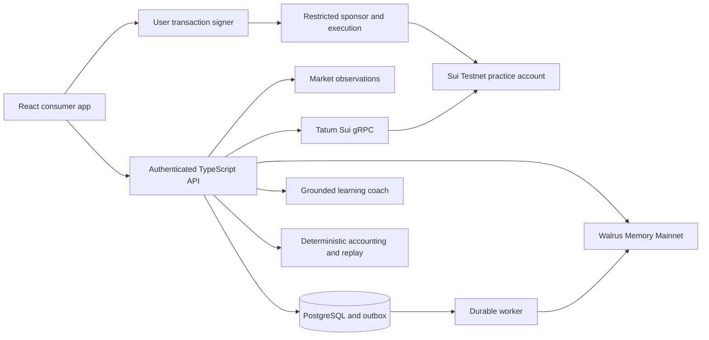

# Trove implementation architecture

Prepared October 26, 2026. Target live architecture, not an audited system. A local SQLite stage now implements the sample product while provider accounts are absent. See [BUILD-STATUS.md](BUILD-STATUS.md) for actual boundaries; the PostgreSQL, authenticated accounts, contracts, and connected providers below remain live implementation targets. Read alongside [FUNCTIONAL-SPEC.md](FUNCTIONAL-SPEC.md), [FRONTEND-BRIEF.md](FRONTEND-BRIEF.md), and [FUNCTIONALITY-RESEARCH.md](FUNCTIONALITY-RESEARCH.md).

## Technology choices

Preserve the existing React + TypeScript + Vite application. Add Tailwind for the approved design. Use a small TypeScript Node API, PostgreSQL, a durable job worker, and a pure calculation module. The API is required because Tatum credentials, the memory delegate, model credentials, and sponsorship secrets cannot live in the browser.

| Layer             | Recommended implementation                                                                                                                                                                                                  |
| ----------------- | --------------------------------------------------------------------------------------------------------------------------------------------------------------------------------------------------------------------------- |
| Browser           | Existing React/Vite/TypeScript; Tailwind; React Router; TanStack Query for remote state. Canvas/SVG for the approved graphics.                                                                                              |
| API               | Hono with its Node adapter, Zod request/response validation, same-origin `/api` routes.                                                                                                                                     |
| Database          | PostgreSQL through Drizzle and `pg`; migrations, foreign keys, unique event/idempotency constraints, transactional outbox.                                                                                                  |
| Worker            | Node process polling durable job rows with row locks, leases, bounded retries, and provider-specific cooldowns. No Redis dependency required initially.                                                                     |
| Financial domain  | Pure TypeScript BigInt arithmetic and matching bounded Move arithmetic; deterministic replay independent of the model.                                                                                                      |
| Practice contract | Sui Move on Testnet, with role/actor checks and an explicit quote-attestor trust model.                                                                                                                                     |
| Chain provider    | `@mysten/sui/grpc` using Tatum's native TLS gRPC gateway on the server.                                                                                                                                                     |
| Memory            | `@mysten-incubation/memwal`, managed relayer on Mainnet, called from the server.                                                                                                                                            |
| Coach             | OpenAI Responses API behind a narrow provider interface; `gpt-6-luna`, strict structured output, validated citations and durable local cost reservations. Existing OpenAI credit is used; no Anthropic account is required. |
| Identity/signing  | Preferred Enoki + new `@mysten/dapp-kit-react`; conventional wallet support as a development/reviewer alternative.                                                                                                          |
| Market data       | Marketstack v2 daily observations as the initial adapter target, subject to coverage, entitlement, and public-display checks.                                                                                               |

Native gRPC avoids assuming that Tatum supports the browser SDK's default gRPC-web transport. Use `@protobuf-ts/grpc-transport` + `@grpc/grpc-js` with TLS and `x-api-key` metadata. Do not automatically fall back to an unrelated provider while claiming a Tatum-verified result.

Recommended repository layout, without replacing the starter unnecessarily:

```text
src/                 landing and consumer React app
server/              API, authentication, provider adapters, jobs
shared/              schemas, pure accounting/replay logic, branded IDs
contracts/trove/     Move package and Move tests
drizzle/             PostgreSQL migrations
scripts/             readiness, evidence, dataset import, demo preparation
tests/               financial, integration, authorization, and browser tests
docs/                specifications, research, setup, presentation
```

Serve the built frontend and API under one origin. During development, Vite proxies `/api` to the Node server. Keep the worker durable across API restarts; do not rely on unawaited serverless work after a response.

## Data and authority flow



The Sui practice account establishes balances, positions, policy revision, and action sequence. PostgreSQL keeps receipts/projections and private learning records. The market provider supplies observations. The model explains evidence. Walrus supplies persistent learning context. None substitutes for another's authority.

## Identity and role boundaries

- Use an expiring server challenge bound to origin, expected address, network, purpose, and one-time nonce. Verify the signed personal message, consume the challenge atomically, then create an HttpOnly session.
- The SDK's documented zkLogin verification path uses GraphQL; configure the appropriate network explicitly. Normal account reads and transaction reconciliation remain through Tatum. Do not assume a raw wallet address or decoded OAuth JWT proves an authenticated session.
- Store family membership separately from authentication. A new session receives only its verified family/learner roles.
- Parent invites are high-entropy, expiring, single-use tokens stored as hashes and bound to the intended family and role. Redemption does not silently replace an existing parent or learner.
- Bind each practice account to the parent and learner addresses. Ownership of a capability must also match its account and the permitted actor.
- The browser signs user actions. The sponsor funds permitted gas, but cannot invent a user's signature. Never hold a real parent's key on the server merely to make the demo easier.
- Decode and validate exact transaction commands before sponsorship; allowlist package/functions, sender, recipients, objects, gas budget, and network. Reject arbitrary transaction bytes even if the portal has an allowlist.
- Rate-limit auth challenges, invitation redemption, sponsorship, quotes, model calls, and memory writes. Scope quotas per authenticated actor/household, with a separate small guest-demo budget.
- Verify origin/CSRF on state changes. Never use a parent/learner selector as authorization.

Enoki's live-app and sponsorship entitlements are an integration preflight. A local/sample tour can work before they are configured, but the final consumer sign-in must not be advertised as functional until exercised. Conventional wallet login is an explicit alternative, not a hidden replacement for the desired Web2 experience.

## Practice-account contract

Recommended objects and records:

| Component                 | Responsibility                                                                                                                                                         |
| ------------------------- | ---------------------------------------------------------------------------------------------------------------------------------------------------------------------- |
| `PracticeAccount`         | One account per learner, shared between authorized parent and learner operations; cash, positions, cost basis, next sequence, revision, policy, daily spending window. |
| Parent capability         | Bound to one account and guardian; required with actor checks for privileged changes.                                                                                  |
| Quote attestor capability | Operator-controlled, separate from parent authority; can issue narrowly scoped paper-price tickets, not change a parent's rules.                                       |
| Quote ticket              | Binds account, actor, instrument, side, reviewed amount, price, observation/dataset identity, expiry, and expected revision/sequence. Consumed atomically.             |
| One-time approval         | Exact action/bounds and named bypass, revision and expiry; consumed atomically. Does not override non-bypassable checks.                                               |
| Events                    | Action committed, policy changed, approval consumed, and supported corporate action applied. No private free-text explanation onchain.                                 |

Use a bounded, configured instrument registry and position count. Every privileged function must enforce authorization; a shared object is publicly referencable and carries no automatic parent/learner protection.

The contract atomically checks the actor, account, correct network/package deployment, paused/expiry state, policy revision, sequence, allowed instruments, quote, bounds, funds/holdings, and applicable limits before changing practice cash/positions and emitting the receipt. Use Sui's Clock for operational expiry and UTC-day spending windows.

Sells do not reimburse the gross daily buy allowance. Both buys and sells consume the account's action sequence. Policy changes increment revision. Reject a second action prepared against the same sequence rather than silently changing what the user reviewed.

Daily market observations can be older than the transaction's operational quote expiry. Record both clocks: quote validity bounds how long the reviewed action may execute; market date/freshness determines whether the underlying observation is acceptable for the stated daily-paper mode. Holidays and weekends are calendar gaps, not automatically missing sessions.

### Price trust

The initial price ticket attests the server's validated market snapshot. The contract enforces the ticket and arithmetic; it does not independently prove the upstream vendor reported the true market price. This is an explicit operator trust boundary appropriate to this practice product, not a trustless stock oracle claim.

A Pyth adapter can replace/enhance this boundary later if the exact equity feed, interpretation, current Sui deployment, and API entitlement are verified. It is not required to make the memory or consumer experience meaningful, and must not be added as a decorative badge.

Record package ID, source commit, upgrade authority, and network in reviewer evidence. Retained upgrade authority is a trust assumption; do not claim that the operator can never change the contract.

### Private decision commitment

Before execution, persist the immutable decision envelope and its durable outbox record. Include action details, actual stated reason if provided, snapshot ID, policy revision, actual time, and optional historical scenario time. Compute a canonical commitment with a random salt. Place only the digest and opaque identifiers onchain.

The salt reduces dictionary guessing of a short private reason. Keep the salt with the authorized private record. A commitment binds the later-revealed bytes to an executed decision; it does not establish that the reason is true or that a historical simulation was actually performed in the past. Later reflections/corrections are new versions, not rewrites of the original envelope.

## Accounting and replay

Recommended internal scales: one dollar = 1,000,000 integer microdollars; one share = 100,000,000 integer share units. Carry integer values as decimal strings across JSON. Never use JavaScript binary floating-point balances.

For a dollar-budget buy with price in microdollars per whole share:

```text
units = floor(budget * shareScale / price)
debit = ceil(units * price / shareScale)
```

For a sell:

```text
credit = floor(unitsSold * price / shareScale)
```

Reject zero-unit orders, nonpositive prices, overflow, unsupported scales, and invalid signs. Use widened checked intermediates in Move and bound inputs before multiplication. Buy/sell rounding must not create a profitable round-trip from dust. Allocate cost basis deterministically; closing a position releases its full remaining cost basis.

Use the same documented assumptions in portfolio and replay views. Initial replay is buy-and-hold from the selected start snapshot, including residual cash, with no fees, slippage, taxes, leverage, or interest. State those assumptions. Compare absolute value and relative change; do not label a simple price comparison as risk-adjusted performance.

Support splits from explicitly validated corporate-action records, with idempotent application and a clear fractional-unit policy. Initial comparisons are price-return comparisons: dividends are excluded and disclosed, not silently double-counted via adjusted prices. Do not combine adjusted historical prices with separate dividend credits. Unknown corporate actions or unexplained data discontinuities disable the affected comparison until resolved.

Store raw and adjusted fields distinctly. Do not use today's fully adjusted series as the execution price a historical learner supposedly observed. Historical cards expose only information permitted by the scenario cutoff; future prices remain hidden until the scenario advances. Freeze the dataset hash, bar dates, data version, price basis, corporate actions, and replay assumptions so results are reproducible.

The real portfolio accumulates actual confirmed practice actions over time. A guided historical exercise is a separate scenario account/domain and may not inject historical cash/positions into that portfolio. Operational expiry always uses real chain time, not a simulated date.

## Market-data adapter

Target Marketstack v2 (`https://api.marketstack.com/v2`). The vendor's published OpenAPI document was inspected; `/v2/eod`, `/v2/eod/latest`, splits, and dividends exist. Do not copy v1 tutorials into the build.

Fetch on the server and cache per symbol/date, not once per visitor. Each requested symbol consumes provider quota even in a batched HTTP request. Paginate fully, sort by date, normalize exchange/currency, reject duplicates and nonpositive/inconsistent observations, and store observation time separately from receipt time.

Track a market session date in its exchange timezone, an actual observation/availability timestamp, and ingestion time. A weekend gap should not be forward-filled and presented as a new daily observation. Reject an unavailable symbol rather than inventing data.

Keep development fixtures explicitly synthetic. Before a public demo, confirm display/caching/data-export rights for the selected account plan. API access and advertised commercial use alone do not prove permission to republish raw datasets into a public repository or permanent Walrus blobs. Public replay exports can include assumptions and hashes without redistributing provider data.

## Walrus memory implementation

Use the managed Mainnet client first. Initial deployment follows the documented operator-account pattern: one operator `MemWalAccount`, server-held delegate credentials, and opaque server-derived namespaces for learner learning context and parent-shareable summaries. This means the operator owns the memory account. It does not establish user-owned memory or cryptographic isolation among households.

Enforce authorization on every read/write and derive namespace from the verified household/learner identity. Never accept a caller-selected namespace. The account delegate can access all its namespaces. An eventual per-family-owned account mode is an explicit upgrade, not an implied property of the initial deployment.

Typed memory envelope fields:

```text
schemaVersion, eventId, opaqueLearnerId, kind,
recordedAt, scenarioAt?, decisionId?, receiptDigest?,
datasetVersion?, conceptId?, sourceRecordIds[],
statementKind, text, supersedesRecordId?, sharingScope
```

Separate verbatim statements from derived hypotheses. Avoid names, email addresses, birthdays, secrets, and sensitive household finances in durable learning text. Keep identity/contact data in the appropriate account store. The managed relayer and the model provider may process plaintext; encryption at rest is not end-to-end privacy from them.

### Durable write path

1. Save the domain event and memory outbox record in the same database transaction. Use a stable operation key derived from the event, not a fresh key on retry.
2. The worker calls `remember` and persists its accepted `job_id`. Acceptance is not a confirmed memory.
3. Poll that job with bounded backoff and respect rate-limit cooldowns. A timeout means unresolved, not cancelled or failed.
4. On `done`, persist the blob ID and namespace; reconcile relevant Mainnet object metadata. Store the confirmation separately from transaction success.
5. An execution can be confirmed while its memory is still syncing. Show that honestly, then update the view when confirmation arrives.
6. Count distinct confirmed useful memories for the submission evidence. Do not use the length of a relevance-ranked recall result as an inventory count.

SDK 0.1.10 has metadata inventory methods, including cursor pagination and expiry fields. They are not exact text reads. `listMemories` applies namespace filtering client-side: the server can return an empty filtered page with `has_more=true`. Consume all pages, handle `must_resync`, and do not expose the operator's account-wide inventory to users. Validate these methods against the managed service before relying on them.

### Recall and correction

Retrieve a bounded set of candidate memories from the authorized namespace, then validate their schema, learner scope, dates, record type, active version, and source references. Load known correction/version metadata deterministically before selecting context. Use separate queries for specific concepts/history if necessary. Never assume the highest-similarity result is the newest or most authoritative fact.

Balances and permissions do not come from recall. The exact decision page is loaded by ID from the private event store with its immutable memory/receipt evidence; semantic recall determines relevant learning context, not exact financial state.

Feed recalled text to the coach as untrusted data, outside higher-priority instructions. The coach's available tools are read-only and scoped. Validate returned source IDs and exercise IDs. Record which confirmed memories influenced each intervention so the reviewer can see the causal product difference.

Support expiry visibility and an owner-managed renewal/removal path. Blob renewal/deletion details depend on object ownership and the provider's enabled endpoints. Revoking a delegate does not retract already-read data. `restore` repairs the relayer index but has documented discovery limits; do not promise complete arbitrary-scale recovery from one call.

## Persistent records

Recommended tables: identities, sessions/challenges, households/memberships, invitations, practice-account mappings, policy snapshots, decision intents, receipts, immutable market snapshots, corporate actions, replay runs, reflections, concept attempts, memory outbox/jobs, memory handles/version links, coaching interventions, and reviewer evidence manifests.

Use unique constraints for actor + idempotency key, chain digest, action sequence, corporate-action application, and memory event key. Preserve payload hashes so reusing a key with changed content yields a conflict.

Use explicit states, not a single `success` boolean:

| Process         | States                                                                                     |
| --------------- | ------------------------------------------------------------------------------------------ |
| Practice action | draft, previewed, awaiting signature, submitted, confirmed, refused, cancelled, unresolved |
| Memory          | queued, accepted, running, uploaded, confirmed, failed, unresolved                         |
| Approval        | requested, approved, declined, expired, invalidated, consumed                              |
| Market snapshot | valid, stale-for-mode, incomplete, unsupported                                             |

On a lost submission response, reconcile the known digest/sequence through Tatum before preparing another action. On a lost memory acceptance response, retry the unchanged payload with its stable operation key. Neither domain promises global exactly-once delivery; idempotency and reconciliation prevent duplicated effects.

## API outline

| Area             | Endpoint responsibilities                                                                                      |
| ---------------- | -------------------------------------------------------------------------------------------------------------- |
| Session          | Issue/consume challenge, return current authorized identity, logout.                                           |
| Family           | Create family, issue/redeem invite, list authorized members.                                                   |
| Markets          | Catalog, company details, validated chart snapshots, freshness metadata.                                       |
| Practice account | Read Tatum-backed state, preview action, build/review transaction, sponsor permitted bytes, reconcile receipt. |
| Decisions        | List authorized decisions, exact decision story, append reflection/correction.                                 |
| Replay           | Validate selected allocations, calculate against a frozen dataset, return traceable results.                   |
| Coach            | Load scoped evidence, return validated response and source references; no execution tools.                     |
| Learning         | Present curated exercise selected from history, record response and progress evidence.                         |
| Parent           | Read shared progress, propose/build policy change, handle exact approval requests.                             |
| Memory           | Show authorized memory status/source handles; correct/remove through appropriate lifecycle.                    |
| Reviewer         | Redacted integration evidence and repeatable demo path; no production secrets or private learner content.      |

Define these as typed contracts before connecting UI events. Use unambiguous types for Mainnet memory-account IDs and Testnet practice-account IDs; identical-looking `0x...` strings are not interchangeable.

## Current implemented slice

The local implementation now uses built-in SQLite and salted scrypt username/password accounts, hashed expiring sessions, and single-use family invitations. This does not require Enoki/Google keys. Parent consent gates Mainnet memory writes; guest sample history stays local. Confirmed active records are recalled by server-derived family scope and checked against local canonical history before OpenAI sees them. A persistent reply cache and cost ledger control generation. Ten demo-learning memories and fresh-session correction-aware coaching were verified. These are the current implementation choices; PostgreSQL deployment, wallet/zkLogin signing, Move account enforcement and production account recovery described above remain future work.
