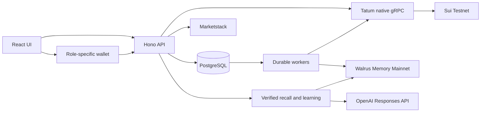

# Architecture

Trove runs a React application and a Hono API backed by PostgreSQL, with SQLite available locally, durable workers, Sui Testnet practice accounts, Walrus Mainnet memory, Marketstack observations, and an OpenAI learning guide.

## Runtime

The optional production Node process serves `dist/`, same-origin `/api` routes, and `/health`. PostgreSQL deployments schedule bounded memory publication, chain reconciliation, and shared market-import work after requests. Local SQLite development uses an interval. Shutdown waits for active work before closing storage and transports.

Vercel serves the built frontend and bounded Node API functions. A pooled DATABASE_URL connects each instance to Neon PostgreSQL. Without that setting, local development uses SQLite in TROVE_DATA_DIR. Both adapters expose asynchronous operations with transaction-scoped connections.

## Modules

| Module                        | Responsibility                                                                                      |
| ----------------------------- | --------------------------------------------------------------------------------------------------- |
| `server/app.ts`               | Routes, schema validation, family scope, origin checks, and role authority.                         |
| `server/auth.ts`              | Password derivation, opaque sessions, hashed invitation tokens, and rate limits.                    |
| `server/store.ts`             | Transactional family state, immutable memory records, and outbox synchronization.                   |
| `server/market.ts`            | Cached imports, immutable dataset versions, corporate-event plans, and portfolio observations.      |
| `server/chain.ts`             | Wallet proofs, fixed transaction construction, sponsorship, durable recovery, and reconciliation.   |
| `server/learning-service.ts`  | Active evidence selection, correction-aware recall, citations, caching, and explanation validation. |
| `server/jobs/`                | Memory operation state, leases, backoff, confirmations, and model-cost reservations.                |
| `shared/model.ts`             | Fixed-point accounting, order rounding, portfolio valuation, and replay.                            |
| `shared/corporate-actions.ts` | Exact split ratios, dividend precision, cost release, cash remainders, and event deduplication.     |
| `shared/chain.ts`             | BCS layouts shared with the Move package.                                                           |
| `shared/learning.ts`          | Deterministic guidance, foundation checks, and transfer scenarios.                                  |
| `contracts/practice/`         | Wallet authority, practice-account rules, signed attestations, and corporate adjustments.           |

## Identity and authority

A guardian creates a family and invites a learner using an expiring, single-use token. Each member has separate credentials. Passwords use salted scrypt derivation; sessions contain random opaque tokens whose hashes are stored in the database.

Server-resolved membership supplies the role and family scope. Wallet-link challenges bind the member, address, origin, network, purpose, and expiry. The guardian and learner use distinct addresses. The shared account fixes those addresses and the operator's attestor public key.

Guardian signatures authorize policy changes and exact exceptions. Learner signatures authorize orders. Signed price and corporate-action terms allow a narrowly scoped financial transition. Wallet ownership establishes control of the linked address; family roles are self-service.

## Financial state

USD uses six decimal places and shares use eight. TypeScript uses BigInt; Move uses checked integer arithmetic with wider intermediate calculations. A buy floors shares and rounds the debit up within the reviewed budget. A sale floors proceeds and releases basis proportionally.

Each quote binds a portfolio, immutable dataset, symbol, side, amount, units, price, market date, nonce, expiry, policy revision, and sequence. A quote becomes invalid after a relevant ledger or policy change. Daily limits measure gross buying; sales leave the consumed allowance intact.

The contract is authoritative for a linked onchain account. Tatum execution events and BCS object contents are verified before the local projection changes. Local order and policy routes enforce the same boundary by requiring the chain path for linked accounts.

## Corporate actions

Raw USD observations retain split factors and per-share dividends independently of chart-calendar alignment. Stable event identities combine provider, instrument, event type, and event date. Archived snapshots preserve older events.

A snapshot transition projects split and dividend entries over held positions. Splits precede dividends on the same instrument and day. Reverse-split fractions below share precision produce cash-in-lieu and proportional basis release. Distribution credits use the provider event date and become available when the portfolio adopts that snapshot.

Local accounts post the journal and snapshot change in one database transaction. Sui accounts submit an atomic group of attested adjustment calls. Persistent dynamic-field markers prevent duplicate events onchain. Reconciliation validates each event's date, quantities, cash, basis, sequence, and snapshot references, then checks the resulting account balances and unchanged policy before committing.

Original decisions remain immutable. Daily portfolio marks preserve observed values; historical reconstruction includes booked corporate entries and their original price basis. Price trends and allocation replay use adjusted closes.

## Transaction recovery

Transaction bytes, digest, payload, and expected version are persisted before submission. The dispatcher uses leases, cooldowns, and bounded retries. An uncertain network outcome retains the same digest and signed bytes.

Confirmed failures release the intent without a ledger debit. Confirmed successes update state, journal entries, quote consumption, and memory work transactionally. Receipt replay is idempotent. A unique index permits one active sponsored transaction at a time. Family locks and optimistic versions prevent stale writes; PostgreSQL advisory locks serialize budget reservations, invitation use, job claims, and shared imports.

Corporate maintenance has a separate rate allowance and persisted exponential backoff. The worker reconciles pending submissions before preparing additional work. The UI polls while a confirmation or adjustment is pending.

## Memory lifecycle

Guardian consent gates publication. Eligible local learning events become immutable journal records with stable operation keys. The outbox persists acceptance IDs, polling state, leases, cooldowns, and confirmed blob evidence.

Recall is scoped to the authenticated family and cross-checked against the active journal, record identity, content, and blob confirmation. Corrections supersede earlier records. Pending corrections hold back explanations based on stale context. Withdrawal removes a record from the active learning context; published data follows Walrus retention semantics.

## Learning and costs

Eight concepts have foundation and transfer exercises with persisted scenario versions and deterministic scoring. Learning results and financial permissions remain separate.

The guide receives bounded verified evidence and deterministic facts. Structured responses must cite the selected records and pass schema and grounding checks before caching. Model calls reserve estimated cost in a persistent database ledger; completed usage settles that reservation. Shared request limits and cached replies bound demand.

## Delivery

The default deployment uses Vercel and Neon. Request-driven maintenance runs with waitUntil; PostgreSQL leases coordinate instances, and persisted operation state resumes on later requests. See [Vercel deployment](VERCEL-DEPLOY.md). The optional Docker server also supports PostgreSQL.
